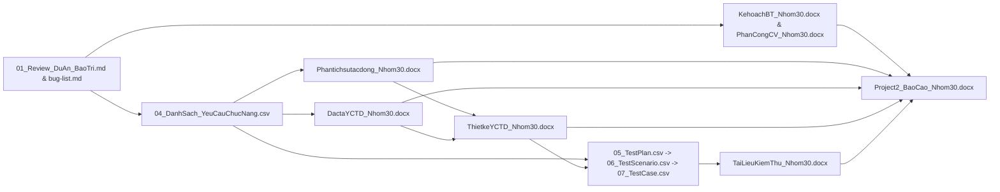

# Kế hoạch Biên soạn Hệ thống Tài liệu Dự án (`document/`)

**Vai trò lập kế hoạch:** Kỹ sư Quản lý Dự án Phần mềm (PM) & Kỹ sư Bảo trì Phần mềm  
**Phạm vi:** Chuyển đổi, biên soạn và chuẩn hóa toàn bộ bộ tài liệu `.docx` trong thư mục [document/](../) dựa trên dữ liệu thực tế của hệ thống **`QLThuVien`** lưu trong [document/ref/](README.md) và [bug-list.md](../../bug-list.md).

---

## 1. Hiện trạng Thư mục `document/` & Mục tiêu Chuyển đổi

Hiện tại thư mục [document/](../) chứa 07 tệp `.docx` mẫu từ dự án tham khảo trước đó (*Euler-Cycle-Visualisation* và *CTU-Scheduler*). Cần thực hiện thay thế toàn bộ nội dung sang hệ thống **Quản lý Thư viện (`QLThuVien`)** với 12 yêu cầu bảo trì (`COR-01`..`COR-04`, `ADP-01`..`ADP-03`, `PRF-01`..`PRF-03`, `PRV-01`..`PRV-02`), đảm bảo tính nhất quán 100% giữa mã nguồn, báo cáo, đặc tả, thiết kế và tài liệu kiểm thử.

---

## 2. Cấu trúc Ánh xạ & Đề cương Chi tiết Từng Tài liệu

| STT | Tệp đích (`document/*.docx`) | Tài liệu nguồn tham chiếu (`document/ref/`) | Cấu trúc chương mục trọng tâm cần viết cho `QLThuVien` |
|---|---|---|---|
| **1** | `KehoachBT_Nhom30.docx` | `01_Review_DuAn_BaoTri.md`, `03_BangPhanCong_CongViec.csv` | - Thông tin dự án `QLThuVien`, tổ chức nhóm & vai trò. - Kế hoạch chi tiết theo 4 tuần/cột mốc (Chuẩn bị → Phân tích/Đặc tả → Thiết kế/Kiểm thử → Tổng kết). - Quy trình bảo trì IEEE/ISO, quản lý cấu hình (Git branches, versioning), quản lý chất lượng & tài nguyên. |
| **2** | `Phantichsutacdong_Nhom30.docx` | `01_Review_DuAn_BaoTri.md`, `04_DanhSach_YeuCauChucNang.csv`, `bug-list.md` | - Bối cảnh & tiếp nhận 12 yêu cầu thay đổi/bảo trì (`COR-01..04`, `ADP-01..03`, `PRF-01..03`, `PRV-01..02`). - Ma trận phân tích tác động (Impact Analysis) tới từng Controller, Service, Model MongoDB, Route Vue và Test Case. - Đánh giá rủi ro hồi quy, ước lượng nỗ lực và quyết định phê duyệt phạm vi bảo trì. |
| **3** | `DactaYCTD_Nhom30.docx` | `04_DanhSach_YeuCauChucNang.csv`, `01_Review_DuAn_BaoTri.md` | - Mục tiêu, đối tượng sử dụng (`DocGia`, `NhanVien`, `Admin`) và thuật ngữ nghiệp vụ thư viện. - Đặc tả yêu cầu chức năng cần điều chỉnh/hiệu chỉnh (`COR-01..04`, `PRF-03`) và tính năng mới (`PRF-02` Xuất báo cáo/thống kê, Chỉnh sửa sách). - Đặc tả yêu cầu phi chức năng (Bảo mật `ADP-01`, Hiệu năng/Index `PRF-01`, Triển khai Docker `ADP-02`, Logging/Maintainability `PRV-01..02`). |
| **4** | `ThietkeYCTD_Nhom30.docx` | `01_Review_DuAn_BaoTri.md`, `backend/app/models/*` | - Thiết kế kiến trúc 3 tầng phân tách Frontend (Vue 3 SPA) — Backend (Express MVC + Service + Middleware/Validator) — MongoDB. - Từ điển dữ liệu chi tiết 5 collection chính (`Sach`, `NhaXuatBan`, `DocGia`, `NhanVien`, `YeuCauMuonSach`) + hướng xử lý `TheoDoiMuonSach` (`PRV-01`) + bổ sung Index (`PRF-01`). - Thiết kế luồng chi tiết & API Contract (`ADP-03`) cho các ca mượn/trả đồng bộ `SoQuyen` (`COR-01`), cập nhật ảnh bìa (`COR-04`), phân quyền JWT (`ADP-01`). - Bảng truy vết ngược (Traceability Matrix) về mã yêu cầu. |
| **5** | `TaiLieuKiemThu_Nhom30.docx` | `05_TestPlan.csv`, `06_TestScenario.csv`, `07_TestCase.csv` | - Kế hoạch kiểm thử (`05_TestPlan.csv`): tính năng kiểm thử / không kiểm thử, phương pháp (Black-box UI + API Integration + Regression), tiêu chí Pass/Fail, tiêu chí đình chỉ. - Quản lý kiểm thử: môi trường (`Node/Express/MongoDB seeded` + `Vue Vite`), vai trò, rủi ro. - Nhúng bảng Kịch bản kiểm thử (`06_TestScenario.csv`) và Bộ Test Case chi tiết (`07_TestCase.csv`) gồm cả ca `Pass` (Frontend) và ca tái hiện 12 lỗi/tồn đọng (`Fail_KnownBug` / `Pending_Maintenance`). |
| **6** | `PhanCongCV_Nhom30.docx` | `03_BangPhanCong_CongViec.csv` | - Bảng phân công nhiệm vụ theo WBS & RACI, thời hạn từng hạng mục, sản phẩm đầu ra, tỷ lệ hoàn thành và đánh giá kỷ luật. |
| **7** | `Project2_BaoCao_Nhom30.docx` | Tất cả tài liệu trên + `01_Review_DuAn_BaoTri.md` | - Báo cáo tổng hợp đóng gói 5 phần: (1) Kế hoạch bảo trì, (2) Phân tích tác động, (3) Đặc tả yêu cầu thay đổi, (4) Thiết kế bảo trì, (5) Kết quả kiểm thử & Phân công nhóm. |

---

## 3. Luồng Phụ thuộc Biên soạn Tài liệu (Document Dependency Flow)

---

## 4. Lộ trình Thực hiện theo Cột mốc (Milestones)

| Cột mốc | Khung thời gian gợi ý | Nội dung công việc chính | Tài liệu đầu ra hoàn thiện | Tiêu chí kiểm duyệt (Quality Gate) |
|---|---|---|---|---|
| **M1 — Khởi động & Review Baseline** | Ngày 1 – Ngày 2 | Chạy `seed.js`, rà soát mã nguồn FE/BE, thống nhất 12 lỗi bảo trì và phân công nhóm. | `01_Review_DuAn_BaoTri.md`, `03_BangPhanCong_CongViec.csv`, `KehoachBT_Nhom30.docx`, `PhanCongCV_Nhom30.docx` | Toàn nhóm thống nhất danh sách 12 mã lỗi (`COR/ADP/PRF/PRV`) và bảng phân công RACI. |
| **M2 — Đặc tả & Phân tích Tác động** | Ngày 3 – Ngày 5 | Lập danh sách yêu cầu chức năng/bảo trì, đánh giá phạm vi ảnh hưởng tới API/DB/UI. | `04_DanhSach_YeuCauChucNang.csv`, `Phantichsutacdong_Nhom30.docx`, `DactaYCTD_Nhom30.docx` | 100% mã yêu cầu có mô tả đầu vào/đầu ra, tác nhân và ma trận tác động tới tệp mã nguồn. |
| **M3 — Thiết kế & Xây dựng Bộ Kiểm thử** | Ngày 6 – Ngày 9 | Thiết kế sửa đổi kiến trúc/CSDL/API; viết Test Plan, Test Scenario, Test Case và thực thi kiểm thử baseline. | `ThietkeYCTD_Nhom30.docx`, `05_TestPlan.csv`, `06_TestScenario.csv`, `07_TestCase.csv`, `TaiLieuKiemThu_Nhom30.docx` | 100% yêu cầu chức năng & 12 hạng mục bảo trì được phủ bởi Test Case; chạy test ghi nhận bằng chứng Pass/Fail. |
| **M4 — Tổng hợp, Rà soát chéo & Nộp Báo cáo** | Ngày 10 – Ngày 12 | Rà soát chéo số liệu giữa các `.docx` và `.csv`, đồng bộ định dạng mục lục/bảng biểu, hoàn thiện báo cáo tổng hợp. | `Project2_BaoCao_Nhom30.docx` & Bộ tài liệu `.docx` bản Final | Không còn dấu vết nội dung đề tài mẫu cũ (*Euler / CTU-Scheduler*); khớp 100% tên route, API, model của `QLThuVien`. |

---

## 5. Quy chuẩn Biên soạn & Kiểm tra Chất lượng (Documentation Standards)

1. **Tính nhất quán thuật ngữ:**
   - Dùng thống nhất tên hệ thống: **Hệ thống Quản lý Thư viện (`QLThuVien`)**.
   - Dùng thống nhất mã trạng thái phiếu mượn thực tế trong CSDL: `DangCho`, `DaDuyet`, `DaTra`, `TuChoi` (Frontend có hỗ trợ hiển thị `ChoDuyet` tương thích ngược).
   - Dùng thống nhất tên collection MongoDB: `Sach`, `NhaXuatBan`, `DocGia`, `NhanVien`, `YeuCauMuonSach`, `TheoDoiMuonSach`.
2. **Loại bỏ hoàn toàn nội dung mẫu cũ:** Kiểm tra tìm-thay-thế các từ khóa như `Euler`, `CTU-Scheduler`, `TimetableMask`, `Avalonia`, `dkmh.ctu.edu.vn` trước khi xuất bản final.
3. **Truy vết hai chiều:** Mọi hạng mục trong `DactaYCTD`, `Phantichsutacdong`, `ThietkeYCTD` và `TaiLieuKiemThu` đều phải tham chiếu đúng mã `FR-xx`, `COR-xx`, `ADP-xx`, `PRF-xx`, `PRV-xx` và `TC-xx`.
